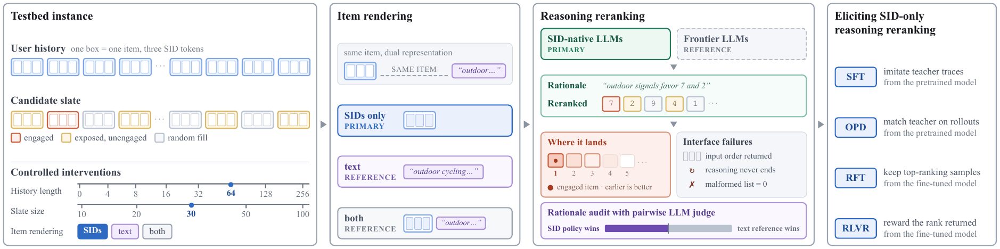

<p align="center">
  
  &nbsp;&nbsp;&nbsp;&nbsp;
  
</p>

<h1 align="center">ReRankID</h1>

<p align="center">
  <b>Reasoning Reranking with Semantic IDs as the Sole Item Representation</b><br>
  Zhenwei Tang<sup>1,2</sup>, Jintao Liu<sup>1</sup>, Di Bai<sup>1</sup>, Xidong Wu<sup>1</sup>, Xinwu Cheng<sup>1</sup><br>
  <sup>1</sup>Google &nbsp; <sup>2</sup>University of Toronto
</p>

<p align="center">
  <a href="https://huggingface.co/datasets/lilvjosephtang/ReRankID">Data</a>
</p>



## Overview

Reasoning rerankers write a rationale before ranking a candidate slate, and existing systems read
item metadata to do so, even though generative recommenders increasingly represent items as compact
Semantic IDs (SIDs). ReRankID is a controlled testbed in which a model reasons and ranks from a user
history and a slate shown only as SIDs, varying item rendering, history length and slate size one
at a time. On it, SID-pretrained recommenders (`OpenOneRec/OneRec-1.7B-pro`,
`OpenOneRec/OneRec-8B-Pro`) often copy the input order instead of reranking, and we compare four
post-training methods that elicit the missing behavior: supervised fine-tuning (SFT),
rejection-sampling fine-tuning (RFT), on-policy distillation (OPD) and reinforcement learning with
verifiable rewards (RLVR). The strongest model, the 8B model trained with a graded ranking reward,
matches strong text-reading LLMs whose prompts are about 20x longer.

## Setup

Run everything from the repository root. Two conda environments cover all stages: `sid-lf`
(LLaMA-Factory SFT and RFT training, figures and tables) and `sid-verl` (vLLM scoring, RFT
sampling, OPD and RLVR). The `cu130` profile is the default; OPD training and the scoring of the
OPD and RFT checkpoints used `cu128`.

```bash
bash code/envs/setup_envs.sh --profile cu130 all
conda activate sid-verl && python code/envs/verify_env.py --role verl --profile cu130 --imports
```

See [`code/envs/README.md`](code/envs/README.md) for profiles, flash-attn and verification.

## Data

The benchmark, all post-training datasets and the per-user results behind every table and figure
are on Hugging Face at
[`lilvjosephtang/ReRankID`](https://huggingface.co/datasets/lilvjosephtang/ReRankID). Accept its
terms on the Hub, set `HF_TOKEN`, then run

```bash
python code/download/release.py --install
```

This downloads into `downloads/rerankid/{data,results}`, checks every file against the bundle's
SHA-256 manifest, and copies the data into `data/`, where the scorers and training launchers read
it. Trained adapters are not released; the stage READMEs train them from the released data.

All data derive from the gated
[`OpenOneRec/OpenOneRec-RecIF`](https://huggingface.co/datasets/OpenOneRec/OpenOneRec-RecIF) at
revision `8f7cf2ee`. To rebuild the benchmark from source on CPU:

```bash
python code/download/recif.py           # pinned raw files into data/recif/, SHA-256 checked
python code/benchmark/build_pools.py    # data/benchmark/pools.parquet
python code/benchmark/build_bench.py    # data/benchmark/bench.parquet
```

This reproduces the released `pools.parquet` and `bench.parquet` row for row. The post-training
pools and datasets are rebuilt with the commands in the stage READMEs.

## Reproduce by paper section

| Paper | Directory | Main command |
|---|---|---|
| Sec. 3 Testbed | [`code/benchmark`](code/benchmark/README.md) | `python code/benchmark/build_bench.py` |
| Sec. 4 Diagnosis | [`code/benchmark`](code/benchmark/README.md) | `python code/benchmark/score_sid.py --model onerec-8b --k-grid 0,4,8,16,32,64,128,256` |
| Sec. 4 Text and baseline references | [`code/benchmark`](code/benchmark/README.md) | `python code/benchmark/score_text.py --backend vertex --model gemini-3.6-flash --emit-rationale` |
| App. D Paired statistics and stability | [`code/benchmark`](code/benchmark/README.md) | `python code/benchmark/paired_stats.py --a A.json --b B.json` |
| Sec. 5 SFT | [`code/sft`](code/sft/README.md) | `bash code/sft/train.sh code/sft/configs/onerec-8b.yaml` |
| Sec. 5 RFT | [`code/rft`](code/rft/README.md) | `bash code/sft/train.sh code/rft/configs/onerec-8b.yaml` |
| Sec. 5 OPD | [`code/opd`](code/opd/README.md) | `bash code/opd/run_opd.sh onerec-8b` |
| Sec. 5 RLVR | [`code/rlvr`](code/rlvr/README.md) | `bash code/rlvr/run_grpo.sh onerec-8b --reward ndcg5` |
| Sec. 5 Rationale audit | [`code/judge`](code/judge/README.md) | `python code/judge/pairwise_judge.py --backend vertex` |
| Figures and tables | [`code/paper`](code/paper/README.md) | `python code/paper/make_main_tables.py` |

Every scorer writes one JSON per setting with the per-user rankings, under the same `results/`
layout as the release (for example `results/diagnosis/onerec-8b/sid/k64_n30.json`), so every
analysis script reads local and released files alike. Released dev files carry the paper's
checkpoint labels (`epoch3.0`, `step100`, `init`), and `code/utils/select_checkpoint.py` works on
both; trained models are selected on the 400 dev users and scored once on the 400 test users.
Rescored numbers match the release closely but not exactly, since greedy vLLM decoding depends on
the vLLM version, tensor-parallel size and batch composition.

## Credentials

`HF_TOKEN` is needed for the gated RecIF data, the OneRec models and the release, and an OpenRouter
key or Vertex AI credentials only for the text-reading references, teacher annotation and the
rationale judge. Instead of `HF_TOKEN` and `OPENROUTER_API_KEY`, a JSON file named by
`API_KEYS_FILE` (default `api_keys.json` in the repository root, ignored by git) can hold the keys
`huggingface` and `openrouter`; the Vertex AI settings are read from the environment only. The
paper's API calls used the providers' zero-data-retention, no-training settings; see
[`code/envs/README.md`](code/envs/README.md).

## License

The code and the released data are under the Apache License 2.0; see [`LICENSE`](LICENSE). The data
derive from OpenOneRec-RecIF and their use also follows its terms. The released teacher annotations
and text-reference results contain outputs of commercial LLMs, whose use may also be subject to the
providers' terms.

This is not an officially supported Google product. This project is not eligible for the Google
Open Source Software Vulnerability Rewards Program.
